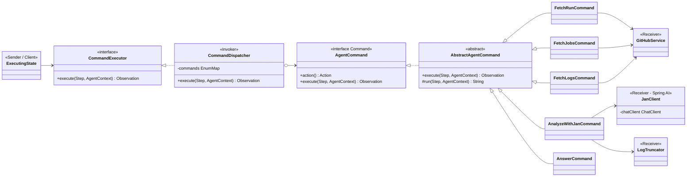
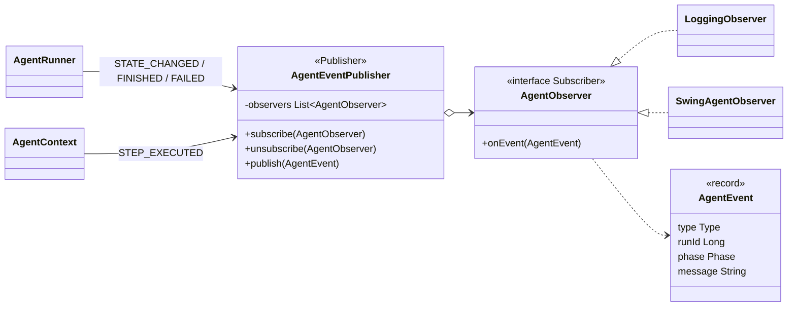

# Minhas contribuições — DevOps Agent

**Gabriel Henrique Rocha** · Projeto em grupo: [AtlazDB/devops-agent](https://github.com/AtlazDB/devops-agent) · Professor Bertoti, FATEC São José dos Campos

Agente que analisa builds que falharam no GitHub Actions usando IA local (JAN) via **Spring AI**.

**Minha parte:** padrões **Command** e **Observer**.

| Padrão | PR | Arquivos criados | Arquivos alterados ou removidos |
|---|---|---|---|
| Command | [#7](https://github.com/AtlazDB/devops-agent/pull/7) | 9 | 6 |
| Observer | [#8](https://github.com/AtlazDB/devops-agent/pull/8) | 5 | 2 |

> Desenvolvido com apoio do Claude (IA da Anthropic) como assistente. Implementação, testes e validação feitos por mim.

---

## 1. Command

**Problema:** o agente só simulava as ações (`StubCommandExecutor`).

**Solução:** cada ação virou um objeto comando; o `CommandDispatcher` (Invoker) escolhe qual executar.

### O que eu criei

| Arquivo | Papel no padrão | O que faz |
|---|---|---|
| `agent/command/AgentCommand.java` | **Command** | Interface comum: `action()` diz qual ação atende, `execute()` executa |
| `agent/command/AbstractAgentCommand.java` | Base (**Template Method**) | `execute()` fixo, com o `try/catch` e a criação da `Observation`; cada comando implementa só o `run()`. Um erro vira uma `Observation` de falha em vez de derrubar a aplicação |
| `agent/command/FetchRunCommand.java` | **Concrete Command** | Busca a run e devolve um resumo (título, status, conclusion) |
| `agent/command/FetchJobsCommand.java` | **Concrete Command** | Devolve **só o id do job com `conclusion=failure`**, o contrato que a `ReActStrategy` e o `AgentRunnerTest` esperam |
| `agent/command/FetchLogsCommand.java` | **Concrete Command** | Baixa o log do job. Se o id não vier no passo (o plan-then-execute planeja antes de saber o id), busca o id no resultado do `FETCH_JOBS` |
| `agent/command/AnalyzeWithJanCommand.java` | **Concrete Command** | Monta o prompt (o papel da IA + o formato da resposta em 3 itens) com os dados coletados e chama o modelo pelo `ChatClient` do **Spring AI** |
| `agent/command/AnswerCommand.java` | **Concrete Command** | Devolve a última análise bem-sucedida como resposta final |
| `agent/command/CommandDispatcher.java` | **Invoker** | Recebe do Spring todos os comandos, guarda num `EnumMap<Action, AgentCommand>` e escolhe o comando sem `if` nem `switch`. Bloqueia dois comandos para a mesma ação |
| `controller/AgentController.java` + `entity/AnaliseResponse.java` | — | Endpoint `GET /api/agent/analisar/{runId}?strategy=`, para rodar o agente pela API. A resposta é um DTO (o `AnaliseResponse` existia vazio e eu preenchi) com `success`, `answer`, `error` e o resultado de cada passo |

### O que eu alterei

| Arquivo | Mudança | Por quê |
|---|---|---|
| `service/LogTruncator.java` (estava vazio) | Mantém só os últimos 6000 caracteres do log, sem cortar linha no meio | O erro fica no fim do log, e um modelo local de 4B tem pouco espaço de contexto |
| `service/GitHubService.java` | `getJobLogs()` passa a seguir o redirecionamento **HTTP 302** do GitHub, **sem** enviar o token ao outro servidor | O log chegava vazio: o GitHub responde com um link temporário, e o `RestClient` não seguia redirecionamentos |
| `agent/StubCommandExecutor.java` | Apagado | Foi substituído pelo `CommandDispatcher` |
| `pom.xml` | Removido o `spring-ai-bom` 1.0.0 duplicado | O Maven usava a versão antiga, incompatível com o Spring Boot 4 |
| `application.properties` | Propriedades do agente (`agent.*`) e leitura do `.env` com `spring.config.import` | Cada integrante usa o próprio token, sem colocá-lo no código (o `.gitignore` já ignora o `.env`) |

### Diagrama

### Decisões técnicas

- **O `ExecutingState` não mudou nenhuma linha**, porque ele só conhece a interface `CommandExecutor`.
- **Para criar uma ação nova, basta uma classe com `@Component`**, sem mexer no Invoker nem nos estados (princípio aberto/fechado).
- **Spring AI isolado num Receiver:** o comando não sabe que fala com o JAN. Trocar de modelo é mudar o `application.properties`.

### Como testei

| Teste | Resultado |
|---|---|
| `AgentRunnerTest` (4 testes que já existiam) | ✅ Continuam passando |
| Run real [`33537076509`](https://github.com/AtlazDB/devops-agent/actions/runs/33537076509) com `plan-then-execute` e com `react` | ✅ `success: true` nas duas |
| Diagnóstico da IA | ✅ Correto: o Maven Wrapper tentava baixar o Maven de um Nexus interno (`10.0.0.13`), inacessível pelo GitHub Actions. O projeto já tinha sido corrigido assim |

---

## 2. Observer

**Problema:** não havia como acompanhar o agente enquanto ele trabalhava.

**Solução:** o agente publica eventos; o `AgentEventPublisher` avisa todos os inscritos (log e tela Swing).

### O que eu criei

| Arquivo | Papel no padrão | O que faz |
|---|---|---|
| `agent/observer/AgentEvent.java` | Evento | Record com tipo (`STATE_CHANGED`, `STEP_EXECUTED`, `FINISHED`, `FAILED`), runId, fase, mensagem e horário, e métodos de fábrica para cada tipo |
| `agent/observer/AgentObserver.java` | **Subscriber** | Interface com `onEvent(AgentEvent)` |
| `agent/observer/AgentEventPublisher.java` | **Publisher** | `subscribe`, `unsubscribe` e `publish`. Lista segura para várias threads (`CopyOnWriteArrayList`), porque a tela roda em outra thread. Um observer com erro é isolado com `try/catch` e não derruba o agente |
| `agent/observer/LoggingObserver.java` | **Concrete Subscriber** | Escreve cada evento no log. Entra sozinho no Publisher por ser `@Component` |
| `test/.../observer/AgentEventPublisherTest.java` | Teste | 5 testes, descritos abaixo |

### O que eu alterei

| Arquivo | Mudança |
|---|---|
| `agent/AgentContext.java` | `record()` publica `STEP_EXECUTED`. Toda `Observation` passa por ali, então cada comando vira um evento com uma linha só |
| `agent/AgentRunner.java` | Publica cada troca de estado e o fim (`FINISHED` ou `FAILED`). Mantive os construtores antigos para o `AgentRunnerTest` continuar funcionando |

### Diagrama

### Como testei

| Teste (`AgentEventPublisherTest`) | O que prova |
|---|---|
| `planThenExecute_publica11EventosNaOrdem` | A ordem e a quantidade de eventos: 11, sendo 5 de comandos |
| `reAct_publicaMaisEventosQuePlanThenExecute` | O ReAct gera 23 eventos, porque passa 5 vezes por PLANNING → EXECUTING → OBSERVING |
| `falhaNoMeio_terminaComEventoFailed` | Quando um comando falha, o último evento é `FAILED` |
| `observerComDefeito_naoDerrubaOAgente` | Um observer que lança exceção não impede os outros nem o agente |
| `unsubscribe_paraDeReceberEventos` | Quem sai da lista não recebe mais nada |

Na run real, o console mostrou 11 eventos com `plan-then-execute` e 23 com `react`. **O Observer deixa visível a diferença entre as duas Strategies.** A janela Swing do colega (Parte 3) usa o Publisher com `subscribe()` e `unsubscribe()`.

---

## 3. Outras contribuições

- Divisão do trabalho do grupo em 3 partes e guia de implementação da Parte 3 (Composite + Swing).
- Revisão e teste do PR [#9](https://github.com/AtlazDB/devops-agent/pull/9) (Composite).
- README do projeto com os diagramas dos 5 padrões.

## Para estudar

- refactoring.guru: [Command](https://refactoring.guru/design-patterns/command) · [Observer](https://refactoring.guru/design-patterns/observer) · [Template Method](https://refactoring.guru/design-patterns/template-method)
- [Spring AI — ChatClient API](https://docs.spring.io/spring-ai/reference/api/chatclient.html)